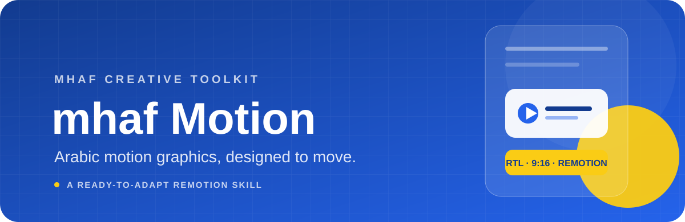

<div align="center">
  
  <br />
  <p><strong>مهارة موشن عربية جاهزة للإنتاج، من الفكرة إلى الفيديو.</strong></p>
  <p>قوالب Remotion · تصميم RTL · خطوات متحركة · موسيقى مركّبة</p>
  <p>
    <a href="#عن-المشروع">عن المشروع</a> ·
    <a href="#التثبيت">التثبيت</a> ·
    <a href="#البدء-السريع">البدء السريع</a> ·
    <a href="#english">English</a>
  </p>
</div>

---

<div dir="rtl">

## عن المشروع

**mhaf-motion** مهارة Claude لإنشاء فيديوهات موشن عمودية بهوية **مْهَفْ mhaf**، بتنسيق **9:16** وبالعربية من اليمين إلى اليسار، باستخدام [Remotion](https://www.remotion.dev/).

بدل ما تبدأ من الصفر، خذ قالب Remotion الجاهز وعدّل النصوص والمشاهد. القالب يضم كابشنات حركية، خطوات مرقّمة، بطاقات ومجلدات وواجهات مصغّرة، انتقالات، وموسيقى مولّدة برمجيًا.

> **الصوت:** القالب يضيف موسيقى ومؤثرات مركّبة، ولا يتضمن تعليقًا صوتيًا.

### ماذا يتضمن؟

| المسار | المحتوى |
|---|---|
| `mhaf-motion/SKILL.md` | تعليمات المهارة وسير العمل |
| `mhaf-motion/references/` | دليل الهوية البصرية وإرشادات الرندر |
| `mhaf-motion/assets/template/` | مشروع Remotion كامل: مشاهد، مكوّنات، خطوط وسكريبتات |
| `dist/mhaf-motion.skill` | حزمة جاهزة للرفع إلى Claude |

## التثبيت

### Claude.ai أو تطبيق Claude

1. نزّل [حزمة المهارة](dist/mhaf-motion.skill).
2. افتح **Settings → Capabilities → Skills → Upload** وارفع الملف.
3. فعّل المهارة وابدأ محادثة جديدة.

### Claude Code

```bash
git clone https://github.com/Naiimbs/mhaf-motion-skill.git
mkdir -p ~/.claude/skills
cp -r mhaf-motion-skill/mhaf-motion ~/.claude/skills/
```

للاستخدام داخل مشروع واحد، انسخ مجلد `mhaf-motion` إلى `.claude/skills/` في جذر المشروع.

## البدء السريع

أعطِ Claude الموضوع، وعدد الخطوات، والرابط أو الحساب الحقيقي، والدقة المطلوبة. مثال:

> نحب فيديو موشن بأسلوب مْهَفْ، 5 خطوات، على كيفاش نخلّي موقع يخدم مع قارئ الشاشة. الرابط: example.com/guide. 1080p.

سيستخدم Claude القالب، ويعدّل النصوص والمشاهد، ويفحص إطارات تجريبية قبل الرندر النهائي.

**مهم:** لا تخترع رابطًا أو حسابًا. استخدم رابطًا حقيقيًا، أو اترك قيمة مؤقتة واضحة واطلب استبدالها قبل النشر.

## التشغيل اليدوي

المتطلبات: **Node.js 18+**، و**FFmpeg**، و**Python 3** مع `numpy` لتوليد الموسيقى.

```bash
cp -r mhaf-motion/assets/template ./video
cd video
npm install
npm run studio            # معاينة حيّة
node stills.mjs 3 20 40   # إطارات اختبار إلى out/
node render.mjs           # رندر مجزّأ وقابل للاستئناف
node assemble.mjs         # تجميع الفيديو والصوت إلى out/final.mp4
```

إعدادات اختيارية للرندر:

```bash
SCALE=0.6667 CONC=2 CHROMIUM_PATH=/path/to/chrome node render.mjs
```

`SCALE=0.6667` يرندر بدقة أقل لتسريع العمل على الأجهزة الضعيفة. راجع [دليل الرندر](mhaf-motion/references/rendering.md) لملاحظات إعداد المتصفح والتجميع.

## أين أعدّل؟

| التغيير | الملف |
|---|---|
| الاسم، الحساب، الرابط، السعر والنصوص | `src/copy.ts` |
| الألوان | `src/theme.ts` |
| ترتيب المشاهد وتوقيتها | `src/Root.tsx` — `SCENES` |
| محتوى المشاهد | `src/scenes1.tsx` و`src/scenes2.tsx` |
| المكوّنات المشتركة | `src/ui.tsx` |
| الموسيقى | `audio.py` |

لإضافة مشهد، انسخ أقرب مشهد في الأسلوب، سجّله في `comps` و`SCENES`، ثم افحص توقيته باستخدام `node stills.mjs <ثانية>`.

## الهوية البصرية

- **الأزرق:** `#2563eb` — اللون الأساسي
- **الكحلي:** `#123b8f`
- **الأصفر:** `#facc15` — لختم «مجانية» أو التحذير فقط
- **النص:** `#0f172a` · **الخلفية:** `#f0f7ff`
- **الخطوط:** Noto Kufi Arabic، IBM Plex Sans Arabic، وIBM Plex Mono

للتفاصيل وقواعد التكوين وRTL، راجع [دليل التصميم](mhaf-motion/references/design-system.md).

## حلّ المشاكل

- **`remotion.media` لا يفتح:** ثبّت `@sparticuz/chromium`، ثم مرّر مسار المتصفح عبر `CHROMIUM_PATH`؛ التفاصيل في [دليل الرندر](mhaf-motion/references/rendering.md).
- **الرندر توقف:** أعد تشغيل `node render.mjs`؛ الأجزاء التي اكتملت تُتخطّى.
- **علامة `@` أو رابط يظهر بترتيب خاطئ:** اضبط `direction: 'ltr'` على العنصر اللاتيني.
- **النص العربي يلتفّ بشكل غير مرغوب:** استخدم `whiteSpace: 'nowrap'` وعدّل حجم الخط.

## قبل النشر

- استبدل رابط `mhaf.app/skill` المؤقت في `src/copy.ts` بالرابط الصحيح.
- راجع مثال السعر «1,899 ريال» في مشهد الإعلان؛ عدّله أو احذفه.
- أضف ملف `LICENSE` مناسبًا قبل إعادة توزيع المشروع.

</div>

---

<div id="english">

## English

**mhaf-motion** is a Claude skill for creating mhaf-branded, vertical **9:16** Arabic motion graphics with [Remotion](https://www.remotion.dev/). It ships with a ready-to-adapt template: kinetic captions, numbered steps, interface-inspired cards and folders, transitions, and synthesized music.

### Install

- **Claude.ai / Claude app:** download [`dist/mhaf-motion.skill`](dist/mhaf-motion.skill), then go to **Settings → Capabilities → Skills → Upload**. Enable it and start a new conversation.
- **Claude Code:**

  ```bash
  git clone https://github.com/Naiimbs/mhaf-motion-skill.git
  mkdir -p ~/.claude/skills
  cp -r mhaf-motion-skill/mhaf-motion ~/.claude/skills/
  ```

### Manual rendering

Requirements: Node.js 18+, FFmpeg, Python 3 and `numpy`.

```bash
cp -r mhaf-motion/assets/template ./video && cd video
npm install
npm run studio
node stills.mjs 3 20 40
node render.mjs
node assemble.mjs
```

Edit copy in `src/copy.ts`, colors in `src/theme.ts`, and scene content in `src/scenes1.tsx` / `src/scenes2.tsx`. See the [rendering guide](mhaf-motion/references/rendering.md) and [design system](mhaf-motion/references/design-system.md).

**Audio note:** the template produces synthesized music and sound effects, not voice-over. Replace all sample URLs, handles, and prices before publishing.

</div>

<div align="center">
  <sub>صُنع بعناية لهوية مْهَفْ · Made for the mhaf visual identity</sub>
</div>
